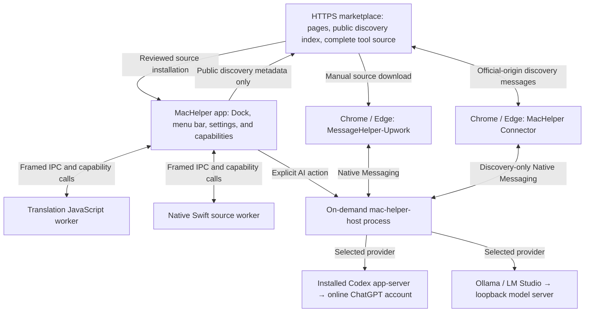

# LocalAIBaseTools — Project Design

This document explains the implemented system for people who need to understand, maintain, or extend it. It describes the code as of 17 November 2026. For everyday use and app installation, start with [README.md](README.md). Public website packaging/deployment documentation is in the [website project](ExtensionMarket-website/README.md) and its [deployment guide](ExtensionMarket-website/DEPLOYMENT.md). For AI-assisted tool creation or modification, use [AI_EXTENSION_GUIDE.md](AI_EXTENSION_GUIDE.md). Private deployment notes are local-only and excluded from Git.

## 1. Purpose and scope

LocalAIBaseTools provides a shared Mac application and independently editable tools that use a user's configured AI connection. A visual marketplace lets users discover tools and download their complete source. The design keeps connection settings, operating-system capabilities, and tool behavior separate so that a new tool does not require another Mac application.

The current products are:

| Component | Current version | What it does |
| --- | --- | --- |
| MacHelper | 6.3.0 (build 630) | App with Dock and menu-bar access, multilingual sidebar settings, editable prompt resources, movable result panels, extension-authoring guide, unified JavaScript/native workers, native hot reload, batch extension actions, keyword/AI tool discovery, and local AI transports. |
| Translation | 4.5.0 | Editable JavaScript tool with localized interface labels that translates selected text and single words using complete user-editable prompt files, with streamed results. |
| MessageHelper — Upwork | 1.4.0 | Chrome/Edge extension that translates messages and previews polished drafts on supported Upwork pages. |
| MacHelper Connector | 1.0.0 | Narrow Chrome/Edge bridge from the official marketplace to MacHelper AI discovery. |
| Extension Market | Static website | Keyword/description search, tool details, illustrated previews, source downloads, and reviewed installation links into MacHelper. |

The public marketplace is [local-ai-extension.nelson007.com](https://local-ai-extension.nelson007.com/). Version numbers above are a snapshot; the manifests and release configuration remain the source of truth.

The website and MacHelper expose 13 interface languages: English, both Chinese scripts, Spanish, French, German, Japanese, Korean, Portuguese, Arabic, Hindi, Russian, and Italian. The website detects browser preferences and stores explicit choices locally; MacHelper has a separate persistent General preference with a System language option. Arabic uses right-to-left layout. Native catalogs live in `MacHelper/Runtime/Localization`; website catalogs are owned by the website. UI changes require matching catalog keys and format parameters. Extension-specific labels come from an optional manifest-declared localization resource, not host-specific settings code. Changing interface language refreshes presentation without restarting source workers, changing the translation target, or rewriting prompts. Technical guides and diagnostics can retain their original language.

“Local AI connection” describes where the integration runs. ChatGPT requests still use an online account and remote inference. Ollama and LM Studio can run inference on the user's Mac. The project does not guarantee free or unlimited provider usage.

## 2. Where each component runs

| Location | Installed or running there | Responsibility |
| --- | --- | --- |
| Linux server | Nginx marketplace container; Caddy reverse proxy | Serve public pages, catalog metadata, source files, ZIP packages, and the MacHelper download over HTTPS. |
| User's Mac | MacHelper.app, source workers, on-demand AI host | Manage settings and permissions, read supported selections, display panels, and contact the configured provider. |
| Chrome or Edge on that Mac | MessageHelper-Upwork; optional MacHelper Connector | Add Upwork controls, or connect official marketplace discovery to the same on-demand native host. |
| Provider environment | Bundled Codex app-server, or Ollama/LM Studio loopback server | Discover available models and perform inference under the user's chosen provider. |

There is no central AI backend in the marketplace. Selected text, message drafts, and model answers are not sent to the marketplace by the application. Installing the website on Linux does not install the macOS app or configure a user's AI account.

MacHelper is a persistent application with a Dock icon and menu-bar shortcut. Clicking its Dock icon opens Settings; closing Settings keeps the app and enabled tools running. Login startup does not open a settings window. `mac-helper-host` is an executable launched when needed, rather than a permanent HTTP daemon. Source extensions' AI capability calls launch the embedded host as a child process. Chrome/Edge launches its registered host copy when the extension connects. Both use shared configuration; the browser does not need an already-open MacHelper settings window.

## 3. Repository structure and ownership

| Path | Responsibility and when to change it |
| --- | --- |
| `MacHelper/App/` | AppKit Dock/menu-bar interface, AI/Extensions/General settings, login registration, permission review, source lifecycle, and marketplace URL handling. Change shared application behavior here. |
| `MacHelper/Runtime/` | Provider clients, model discovery, preferences, framing, browser registration, source-package infrastructure, native source builds, batch-action planning, and the legacy bundle registry. |
| `MacHelper/Runtime/SourcePackages/` | Manifest/catalog validation, complete downloads, safe paths, hashes, editable installation, and source-change watching. |
| `MacHelper/Capabilities/` | Shared Accessibility selection reading, sentence context, panel placement, cancellation, and the native AI client. Changes here affect tools that use those capabilities. |
| `MacHelper/Host/` | `mac-helper-host` entry point for browser and native AI requests. |
| `MacHelper/ScriptWorker/` | Separate JavaScriptCore process that executes source tools through the restricted host interface. |
| `MacHelper/NativeExtensionSDK/` | Standalone Swift worker SDK compiled with an independent native source entry. |
| `MacHelper/ExtensionSDK/` | Legacy in-process Objective-C/AppKit interface retained as migration/development fixture. |
| `MacHelper/Assets/` | MacHelper icon artwork and macOS icon resources. |
| `MacHelper/Tests/` | Swift runtime and capability tests. |
| `Extensions/Translation/` | Translation's manifest, JavaScript, settings schema, prompts, documentation, and license. Most translation wording/behavior changes belong here. |
| `Extensions/MessageHelper-Upwork/` | Independent Manifest V3 browser extension, page integration, popup, and safe test page. |
| `Extensions/MacHelper-Connector/` | Discovery-only Manifest V3 marketplace bridge, fixed public identity, and browser-native tests. |
| `Extensions/*/discovery.json` | Tool-owned searchable descriptions, capabilities, examples, keywords, limitations, platforms, and translated display text. |
| `MacHelper/Runtime/Discovery*` | Verified public metadata cache/seed, keyword retrieval, bounded AI discovery, and URL-prefill validation. |
| `catalog/extensions.json` | Source catalog with complete file inventory, sizes, hashes, and download locations. Regenerate after changing published tool files. |
| `ExtensionMarket-website/` | Static website, visual metadata, package builder/verifier, Docker configuration, and deployment automation. |
| `ExtensionMarket-website/historical-packages/` | Immutable files and ZIPs required by previously published source-package URLs. |
| `docs/` | Detailed extension-development, source-package, and AI protocol contracts. |
| `scripts/` | Mac build/install tools, catalog generation, and integration checks. |
| `test/` | Browser, installer, source-tool, and deployment tests with synthetic fixtures. |
| `examples/NativeGreeting/` | Independent native Swift source-worker example. |
| `examples/ExternalGreeting/` | Legacy native bundle example for migration reference. |
| `dist/`, `ExtensionMarket-website/dist/`, `.artifacts/` | Generated builds, distribution files, or local verification artifacts. These are not the editable source of truth. |

`MacHelper` and `Extensions` are separate development units. Tools use a published interface rather than importing internal application code. A tool can be authored in another repository and installed from a local folder or HTTPS catalog.

## 4. Shared AI connection

`AIProviderClient` selects an explicit provider. Provider adapters implement model listing and text transformation; the host applies common validation and returns a consistent result.

| Provider | Transport | Requirements and behavior |
| --- | --- | --- |
| ChatGPT | Bundled `codex app-server --listen stdio://` from an installed Codex/ChatGPT app | Signed-in ChatGPT account; online inference. Each operation uses a short-lived process. Transformation requests use ephemeral threads with tools, MCP, and web search disabled and checked. This is an integration with the bundled app-server, not a public localhost ChatGPT API. |
| Ollama | Loopback HTTP, normally `127.0.0.1:11434` | Ollama running with the requested model downloaded. |
| LM Studio | Loopback OpenAI-compatible HTTP, normally `127.0.0.1:1234/v1` | A model loaded and the local server enabled. |

Remote HTTP provider addresses and redirects are rejected. There is no silent fallback to another provider or model. Model lists come from the selected provider at runtime; this avoids publishing a new tool simply because its available models change, provided the provider protocol stays compatible. ChatGPT's app-server list need not match every model displayed elsewhere in a desktop chat interface.

MacHelper stores a shared default provider/model. MessageHelper can follow that default or save its own named model override in browser storage. An unavailable selected model produces an actionable error.

## 5. Translation flow

1. MacHelper checks selected text exposed through macOS Accessibility in the active application. Selection detection displays a small icon without requesting AI inference.
2. The user clicks the icon. MacHelper captures the selected text and, for one word, tries to read its enclosing sentence within bounded Accessibility ranges.
3. The host invokes Translation's command in its JavaScript worker, passing text, tool settings, and optional sentence context. The script chooses an editable prompt and calls the shared AI capability.
4. Provider output streams through the host and worker into the nearby panel. The actual model name appears with the result. Dragging the panel header changes its position without changing focus, cancelling inference, or resetting its position when new chunks arrive.
5. A validated final answer enables Copy. Esc, a changed selection, app switching, or dismissal cancels/invalidates the request so an older response cannot overwrite a newer one.

One selected word produces a contextual meaning followed by the full sentence translation. Without reliable sentence context, it produces a standalone definition and a notice rather than inventing a sentence. Multiword selections use normal translation.

Editable controls use bounded text ranges. Supported read-only browser text uses Accessibility text markers, including reversed selections and words separated from surrounding text by links or formatting. The code checks paragraph length before reading it, identifies the exact selection, and extracts the sentence locally. It does not read the whole browser document or execute a DOM script.

Current context limits include eight focused ancestors, 2,000 UTF-16 units / 8,000 UTF-8 bytes, and approximately a 1.5-second lookup budget. Protected fields, images, unsupported Accessibility implementations, and oversized paragraphs may have no context. There is no OCR implementation. Selection detection never simulates Copy or changes the clipboard automatically. The current capability pipeline accepts verified selected text; obsolete demo and clipboard-reading paths have been removed. The result's explicit Copy button remains available.

## 6. MessageHelper-Upwork flow

The content script identifies supported message, proposal-conversation, and Leave Feedback sections and injects controls. The background process uses Chrome/Edge Native Messaging to request AI work from the shared host.

- Translate shows output below the original message or translates a feedback draft without changing it.
- Polish returns a preview. Apply explicitly inserts it into the draft; Cancel preserves the draft. Undo is offered while the inserted draft remains unchanged.
- Sending messages, selecting ratings, and submitting feedback remain user actions. Neither tools nor automated tests may send or submit anything on Upwork.

Browser source changes require reloading the extension in `chrome://extensions` or `edge://extensions`, then refreshing affected pages after preserving drafts. This is separate from Translation's source-worker hot reload. Current distribution uses Developer mode / Load unpacked; browser-store publication is not implemented.

## 7. Extension interfaces and reload behavior

There is one source extension system with two execution adapters, plus the browser companion format:

| Runtime/format | Integration | Reload behavior |
| --- | --- | --- |
| JavaScript source | Schema-2 manifest with `runtime: "javascript"`, `.js` entry, schema/resources in a `.macsource` folder. | Validate and replace only that JavaScriptCore worker. |
| Native Swift source | The same schema-2 package with `runtime: "native"`, one `.swift` entry, and approved `native.execute`. | Fixed compiler builds a validated/signed candidate; successful startup replaces only that native worker. |
| Browser companion | Manifest V3 browser bundle using the AI host's Native Messaging protocol. | Manual browser extension reload and page refresh. |

Both source runtimes use the same installed list, source import, enablement, permission review, settings renderer, Edit Source, and Reload controls. The manifest explicitly selects the adapter. Native source has one Swift entry compiled with the app's standalone SDK into a private cache outside the editable source folder. The cache key includes entry source, SDK, toolchain, and architecture. Resource/settings changes replace the worker with a fresh frozen snapshot and can reuse the compiled executable. MacHelper does not execute an arbitrary manifest build command, install dependencies, or load a native extension library into its own process. Invalid compilation or worker startup keeps the previous working generation alive.

The JavaScript API uses `MacHelper.define`, `MacHelper.readText`, and `MacHelper.ai.transform`; the native API uses `MacHelperNative.run` and the input object's `readText`, `transform`, and `reportProgress` methods. Commands share selected input, optional sentence context, schemas, capability checks, exact prompt ownership, cumulative progress, generation validation, and cancellation. Settings support text, select, boolean, and source-backed prompt fields. The current selection flow invokes the first declared command. Native settings are host-rendered from that schema; arbitrary remote AppKit settings controllers are not implemented.

JavaScript exposes no Node.js, shell, arbitrary filesystem, or general network APIs. Native Swift can use operating-system APIs as the current user and requires explicit `native.execute` approval. Worker isolation enables crash containment/replacement; it is not an OS sandbox or a claim that approved native code is capability-restricted. The shared host AI broker remains answer-only and requires an explicit current action.

The source watcher detects package-file changes, including scripts, prompts, schemas, manifests, and atomic editor saves. It debounces changes and validates a replacement before activation. Syntax, native compiler/signing, startup, or validation errors retain the last working generation; a corrected save can recover. Successful replacement cancels old work and ignores stale progress. New permissions require renewed approval. Disabling a tool stops its worker/watchers while preserving its source and preferences; edits are read when it is enabled again.

Settings uses a left navigation sidebar and a right content pane. The Extensions overview lists installed tools before available catalog tools; selecting a tool opens its detail page. The selected package's schema supplies field names, labels, defaults, and choices to a generic native renderer. Installed disabled tools can load and save configuration without compiling or starting executable code, enabling the tool, or requesting inference. Shared provider/login settings and macOS permission controls remain application responsibilities.

The installed list has separate checkboxes for batch selection, plus Select All, Reload, Edit Source, Enable, and Disable controls. Checking tools is independent of opening a detail page and persists through status refreshes/navigation. Batch actions reuse each tool's existing lifecycle or source-opening path; Reload excludes disabled tools, and enablement skips tools already in the requested state. Actions proceed per tool so one failure or cancelled native approval leaves the other selected tools eligible to finish. Uninstalled catalog entries remain outside batch selection.

Edit Source opens the installed working copy, separately from an author's repository and the compiled application bundle. Re-enabling, reinstalling an existing marketplace entry, and application upgrades preserve local edits. The project does not currently provide automatic source merging or background tool upgrades.

Users can create a tool in a separate repository or customize an installed source package with their own AI coding assistant. [AI_EXTENSION_GUIDE.md](AI_EXTENSION_GUIDE.md) supplies an importable example and a bounded implementation workflow; MacHelper and the marketplace expose guide links alongside their source-editing/discovery interface. No publisher-upload backend is implied by these authoring links.

A runtime migration keeps the stable identifier and compatible settings keys, rewrites commands for the target API, and changes `runtime`/`entryPoint`. Adding `native.execute` requires disable/re-enable approval before compilation/execution. Native-to-JavaScript migration removes that permission and selects the script worker after validation. Legacy schema-1 bundles must migrate their business logic and replace direct `NSViewController` settings with schema fields; they cannot become remote workers by renaming files.

See [Extension Development](docs/Extension-Development.md), [Source Extensions](docs/Source-Extensions.md), and [Native Extensions](docs/Native-Extensions.md) for exact authoring contracts.

## 8. IPC, streaming, and cancellation

The browser/native AI host protocol uses stdin/stdout: a four-byte unsigned little-endian length followed by UTF-8 JSON, with a 256 KiB frame limit. Actions include `ping`, `listModels`, `translate`, `polish`, and `searchExtensions`. Discovery has its own bounded input/result contract and uses shared saved provider/model settings; it does not accept arbitrary provider/prompt overrides. Text and instructions also have independent size limits. An explicit `systemPrompt` is forwarded unchanged as provider instructions and `text` is forwarded separately without the legacy action/tone wrapper or MacHelper's built-in translation instructions. JSON wire escaping does not change the decoded prompt content. Translation uses this path with its prompt files and extension-owned JSON input data. Older action/text-only clients keep their compatibility behavior. Provider tools remain disabled independently of the prompt contents.

Streaming is opt-in. Delta events carry the request ID, text delta, and model, followed by one authoritative final result or error. The source-worker protocol is a separate framed IPC layer: it routes commands and capability calls, and exposes cumulative progress to JavaScript and native Swift. End-of-input, process shutdown, worker replacement, and UI dismissal propagate cancellation. Request IDs and generation checks prevent late frames from changing the current result.

Partial output remains visibly incomplete after a failure, and the panel does not offer it as a successfully completed copyable answer. Consumers must use the terminal result to decide success. See [MacHelper Protocol](docs/MacHelper-Protocol.md) for wire examples and limits.

## 9. Local state and startup

These are per-user locations; `~` means the current user's home directory.

| Path | Contents |
| --- | --- |
| `~/Applications/LocalAIBaseTools/MacHelper.app` | Installed application, embedded AI host/worker, bundled catalog and source seed. |
| `~/Library/Application Support/LocalAIBaseTools/MacHelper/settings.json` | Shared provider, model, and connection preferences. |
| `…/MacHelper/source-extensions.json` | Source-tool state, approved permissions, and catalog locations. |
| `…/MacHelper/Discovery/` | Verified public discovery index/manifest cache; no search queries or answers. |
| `…/MacHelper/discovery-{config,index,manifest}.json` | Public website configuration and release seed beside the browser host. The app also bundles its seed under Resources/Discovery. |
| `…/MacHelper/ExtensionSettings/<id>/settings.json` | Tool preferences kept separately from editable source. |
| `…/MacHelper/SourceCache/<id>.macsource/` | Last working tool source for recovery, not conversation history. |
| `…/MacHelper/NativeBuildCache/<hash>/` | Validated local native executable cache, keyed by source, SDK, toolchain, and architecture; outside editable packages. |
| `…/MacHelper/extensions.json` | Preserved legacy native registry data; new native workers use the shared source registry. |
| `…/MacHelper/mac-helper-host`, `…/MacHelper/allowed-extension-ids.json` | Browser host executable and explicit allowed browser IDs. |
| `~/Library/Application Support/LocalAIBaseTools/Extensions/<id>.macsource/` | Complete editable installed tool source. |
| Chrome/Edge `NativeMessagingHosts` folders under `~/Library/Application Support/` | Browser registrations pointing to the host. |

MacHelper registers login startup through `SMAppService` on its first explicit launch from the installed location. macOS may require approval. A later user disablement is respected, and closing Settings keeps the app running with Dock and menu-bar access. Selection access requires Accessibility approval specifically for MacHelper.

The installed app registers browser support with exact allowed extension IDs. The canonical host name is `com.localaibasetools.mac_helper`; `com.messagehelper.gpt` is a compatibility alias. Both run the same host. Browser clients can launch it on demand; a constantly running network service is unnecessary.

## 10. Marketplace and release design

The website is plain HTML/CSS/JavaScript served by Nginx. There is no production Node process, database, AI gateway, or account service. `marketplace.config.json` supplies presentation metadata; manifests supply tool identity/version and source permissions.

`build.py` generates a verified distribution containing:

- `data/extensions.json` for the visual website catalog.
- `catalog.json` for MacHelper source installation.
- `discovery-index.json` and `discovery-manifest.json` for independent metadata-only search updates.
- Complete versioned source files and ZIPs under `packages/`.
- `downloads/MacHelper-macOS-arm64.zip`, built on macOS before server publication.
- Static pages, artwork, and illustrated previews.

The website's `machelper://install` link opens the native app. MacHelper fetches metadata, presents permissions for review, and downloads the complete source only after installation is approved. The browser cannot silently install the app or grant Accessibility permission. Existing tool installations open settings without overwriting local changes or forcing enablement.

Source packages use complete file inventories with sizes and SHA-256 hashes. Downloads stage and validate before atomic activation. These checks establish consistency with the chosen HTTPS catalog; they are not publisher signatures or a guarantee that a tool is safe. Previously published package URLs are immutable and retained for older app catalogs.

Current production uses a dedicated Docker container behind the existing Caddy proxy. Only the marketplace container is replaced during deployment. A candidate container's full file inventory is checked before publication, Caddy changes are validated and guarded against concurrent edits, and prior release information supports rollback. The legacy `recite.nelson007.com/extension-market` landing address redirects to the new domain; nested legacy package/catalog/download URLs remain directly accessible for older clients that reject redirects.

The Mac app needs a macOS build/signing environment with Swift 6 or later command-line tools and Python 3. The published Apple Silicon download is a developer preview and is not notarized. Linux builds the static website container, not the Mac application. The public [website README](ExtensionMarket-website/README.md) and [deployment guide](ExtensionMarket-website/DEPLOYMENT.md) describe the supported packaging and Docker update workflow. Private machine-specific deployment notes are not distributed.

### Description-based discovery (MacHelper 6.3)

Every newly authored/published tool owns root `discovery.json`; JavaScript, native Swift, and browser packages use the same public descriptor. The website publisher validates schema 1, rejects unknown fields, derives identity/version from the manifest, and combines descriptors into a source-free index. It is required for marketplace publication, while existing installed tools remain runnable without it. Extension-owned translation maps support the same 13 interface languages without moving descriptions into MacHelper source. See [the exact descriptor contract](docs/Source-Extensions.md#public-discovery-metadata-machelper-63).

A small revision manifest names a fixed adjacent index and includes its SHA-256, byte size, timestamp, and content revision. MacHelper checks the manifest first, downloads changed index bytes, validates the pair, and stores it privately. The index is limited to 16 MiB and 10,000 entries. A last verified cache or bundled seed remains available with a stale indication after a network failure; invalid downloads never replace it. Public metadata updates do not require app releases or downloading tool source. The website serves its own static description data for keyword search; there is no server AI gateway.

**Find tools** and the website offer **Keywords** and **Describe need**. Keyword filtering needs no inference. Explicit **Search with AI** uses shared AI Connection settings. For at most 40 tools, a bounded ranking payload is sent directly. Larger indexes first use AI to expand the user's query into at most eight search terms; local lexical retrieval selects up to 40 candidates, then ranking receives at most 160,000 bytes of candidate records. Descriptions are shortened to 1,200 characters, capabilities to the first eight, and the complete selected record must fit before it is added. This does not guarantee exhaustive global semantic matching. AI returns at most five distinct known candidate IDs, reasons, and `good`/`partial` fits; invented/duplicate IDs and malformed output are rejected. Query and metadata are untrusted, with inference tools disabled. Viewing results never installs or executes a tool.

Chrome/Edge website AI search uses Connector ID `kkmffpbghoojlnldpdolonpjmkhdenkh`. Its only browser permission is native messaging, and external messages must come from the exact HTTPS marketplace origin in a top-level tab. Its public protocol permits only status, bounded discovery search, and cancellation; it cannot expose general AI, settings, files, shell commands, or installation. The native endpoint reads the installed public index location rather than any URL supplied by the website. Without the connector, `machelper://search` only prefills **Find tools**; a separate native button starts AI. Native and browser searches share saved model settings and return model/revision/stale information. The [client protocol](docs/MacHelper-Protocol.md) defines both message envelopes.

## 11. Data handling and trust boundaries

Selected text, drafts, downloaded code, and AI answers are data. The default extension prompts mark selected content as untrusted and keep it separate from user-authored instructions. Users can edit the complete extension prompt. AI requests remain answer-only; technical provider configuration grants no tool execution regardless of that prompt.

Application settings and source caches do not store selected text, complete AI request payloads, or generated answers. Source caches include tool code, resources, and static prompt templates. Normal marketplace HTTP access logging may still occur. Provider-side retention or diagnostic records are outside this project's control; an ephemeral request does not guarantee zero records everywhere. ChatGPT account credentials remain with its installed provider, and Linux deployment does not require model credentials.

Use explicit permission review and least-privilege capabilities for new source tools. MessageHelper browser permissions remain restricted to supported Upwork routes, local extension storage, and Native Messaging. The Connector requests only Native Messaging and restricts external senders to the official marketplace. No wildcard native-messaging allowlist is used. Production documentation and artifacts must exclude private environment files, credentials, and real client conversations.

## 12. Verification and change guidance

| Change | Appropriate verification |
| --- | --- |
| Translation scripts/prompts/schema | JavaScript source tests plus `scripts/test-source-extensions.py`; verify reload, invalid-edit recovery, streaming, and preservation of local edits. |
| MacHelper runtime/capabilities | `swift test --package-path MacHelper`; relevant source/native integration scripts and a synthetic selection test. |
| Browser controls | `npm test` and the extension's safe test page; verify Apply/Undo with disabled Send and zero-submit sentinels. |
| Install/startup/browser registration | Python installer tests and an isolated installation check; preserve existing settings and unrelated registrations. |
| Marketplace/packages/deployment | Website build/verification and deployment tests; verify source inventories, download metadata, HTTPS health, and rollback prerequisites. |
| Public discovery/search | Descriptor/index validation, mocked AI ranking/ID checks, connector origin/cancel tests, `scripts/test-discovery.py` for host framing, and the app's `--verify-discovery` isolated UI check; live AI remains separate. |

Live AI checks are separate because they consume the configured account's usage. They use synthetic public sentences and never send Upwork messages. Documentation-only changes need link/command/configuration checks rather than a complete application rebuild. Exact commands are in [README.md](README.md), the [AI extension guide](AI_EXTENSION_GUIDE.md), and the public website documentation.

To change Translation wording, start with its prompts or `main.js`. To add a shared provider or operating-system capability, change MacHelper and its contract/tests. To add a discoverable tool, supply a complete manifest/source package and marketplace metadata. Keep the host, tools, and website independently understandable and releasable.

## 13. Current limits and future work

Implemented clients require macOS 14 or later; the published app targets Apple Silicon. Windows, Linux desktop, iOS, and Android hosts are not implemented. Selection depends on Accessibility support. The current tool interface handles text, not image/audio/video recognition.

The marketplace has no publisher submission backend, moderation workflow, user accounts, payments, ratings, quota marketplace, or sharing of other users' AI accounts/remaining usage. Automatic app updates, signed publisher catalogs, notarized public releases, browser-store distribution, and automatic source-update merging are also future work. Native workers now support source hot reload, while a remote custom AppKit UI protocol, arbitrary build systems/SwiftPM dependency installation, precompiled-native marketplace packages, and automatic legacy bundle conversion remain unimplemented. These should be designed as separate features instead of being assumed to exist in the current static marketplace.

The repository is MIT licensed; third-party providers and distribution platforms have their own terms and technical constraints. See [LICENSE](LICENSE).
