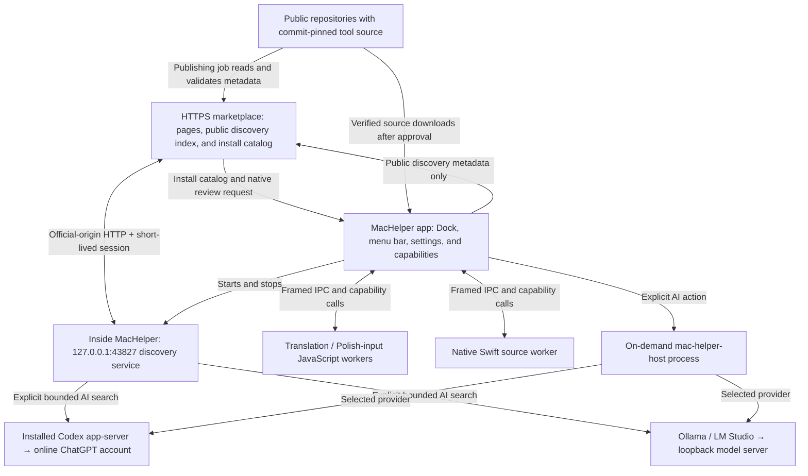

# LocalAIBaseTools — Project Design

This document explains the implemented system for people who need to understand, maintain, or extend it. It describes the code as of 18 November 2026. For everyday use and app installation, start with [README.md](README.md). Public website packaging/deployment documentation is in the [website project](ExtensionMarket-website/README.md) and its [deployment guide](ExtensionMarket-website/DEPLOYMENT.md). For AI-assisted tool creation or modification, use [AI_EXTENSION_GUIDE.md](AI_EXTENSION_GUIDE.md). Private deployment notes are local-only and excluded from Git.

## 1. Purpose and scope

LocalAIBaseTools provides a shared Mac application and independently editable tools that use a user's configured AI connection. A visual marketplace lets users discover tools and download their complete source. The design keeps connection settings, operating-system capabilities, and tool behavior separate so that a new tool does not require another Mac application.

The current products are:

| Component | Current version | What it does |
| --- | --- | --- |
| MacHelper | 6.7.5 (build 675) | App with Dock and menu-bar access, multilingual sidebar settings, editable prompt resources, movable result panels, extension-authoring guide, unified JavaScript/native workers, native hot reload, batch extension actions, a shared icon toolbar with guarded Apply, the website’s AI discovery service, and local AI transports. |
| Translation | 4.5.5 | Editable JavaScript tool with localized interface labels that translates selected text and single words using complete user-editable prompt files, with streamed results. |
| Polish-input | 1.0.5 | Editable JavaScript tool that streams a polished preview and offers explicit plain selected-text replacement in supported Mac apps. |
| Extension Market | Static website | Keyword/description search, tool details, illustrated previews, source downloads, and reviewed installation links into MacHelper. |

The public marketplace is [local-ai-extension.nelson007.com](https://local-ai-extension.nelson007.com/). Version numbers above are a snapshot; the manifests and release configuration remain the source of truth.

The website and MacHelper expose 13 interface languages: English, both Chinese scripts, Spanish, French, German, Japanese, Korean, Portuguese, Arabic, Hindi, Russian, and Italian. The website detects browser preferences and stores explicit choices locally; MacHelper has a separate persistent General preference with a System language option. Arabic uses right-to-left layout. Native catalogs live in `MacHelper/Runtime/Localization`; website catalogs are owned by the website. UI changes require matching catalog keys and format parameters. Extension-specific labels come from an optional manifest-declared localization resource, not host-specific settings code. Changing interface language refreshes presentation without restarting source workers, changing the translation target, or rewriting prompts. Technical guides and diagnostics can retain their original language.

Each tool’s optional `marketplace/preview.json` supplies localized labels, accessible text, and sample content for its website preview. The site renders these through shared lookup, revision, and image layouts. Translation demonstrates a word in context, and Polish-input shows a selected draft, the proposed edit, and the explicit Apply action. The homepage hero uses the first usable preview in registry order. Animations play when visible and display a completed example for visitors who prefer reduced motion. Playback uses authored examples without calling AI, contacting MacHelper, or accessing the clipboard. Authors keep icons and optional still previews in the same `marketplace/` folder. The website loads those images from the registered GitHub commit and selects a localized still when the animated layout cannot render.

“Local AI connection” describes where the integration runs. ChatGPT requests still use an online account and remote inference. Ollama and LM Studio can run inference on the user's Mac. The project does not guarantee free or unlimited provider usage.

## 2. Where each component runs

| Location | Installed or running there | Responsibility |
| --- | --- | --- |
| Linux server | Nginx marketplace container and Caddy reverse proxy | Serve the marketplace, generated catalog and search metadata, historical packages, and the MacHelper download over HTTPS. |
| Public GitHub repositories | Each author’s source, listing assets, and optional release ZIP | Supply source files at approved commits and keep published versions reachable. |
| User's Mac | MacHelper.app with local website service, source workers, on-demand AI host | Manage settings and permissions, serve bounded website search on loopback, read supported selections, display the shared toolbar/panels, validate explicit selected-text replacements, and contact the configured provider. |
| Browser on that Mac | Official marketplace page and supported editable/read-only content | Connect the marketplace directly to MacHelper’s local search service. Translation and Polish-input operate through macOS Accessibility; no browser extension is required. |
| Provider environment | Bundled Codex app-server, or Ollama/LM Studio loopback server | Discover available models and perform inference under the user's chosen provider. |

There is no central AI backend in the marketplace. Selected text, message drafts, and model answers are not sent to the marketplace by the application. Installing the website on Linux does not install the macOS app or configure a user's AI account.

MacHelper is a persistent application with a Dock icon and menu-bar shortcut. Clicking its Dock icon opens Settings; closing Settings keeps the app and enabled tools running. Login startup does not open a settings window. `mac-helper-host` is an executable launched when needed, rather than a permanent HTTP daemon. Source extensions' AI capability calls launch the embedded host as a child process. Compatibility browser clients can launch their registered host copy. Both use shared configuration. Translation and Polish-input require only the MacHelper app, not browser-profile installation. Separately, the running MacHelper app starts its loopback-only website service; website AI search needs that app running, while its settings window may stay closed.

## 3. Repository structure and ownership

| Path | Responsibility and when to change it |
| --- | --- |
| `MacHelper/App/` | AppKit Dock/menu-bar interface, AI/Extensions/General settings, login registration, permission review, source lifecycle, and marketplace URL handling. Change shared application behavior here. |
| `MacHelper/Runtime/` | Provider clients, model discovery, preferences, framing, browser registration, the loopback website service, source-package infrastructure, native source builds, batch-action planning, and the legacy bundle registry. |
| `MacHelper/Runtime/SourcePackages/` | Manifest/catalog validation, complete downloads, safe paths, hashes, editable installation, and source-change watching. |
| `MacHelper/Capabilities/` | Shared Accessibility selection reading, sentence context, selection-action toolbar, guarded plain-text replacement, panel placement, cancellation, and the native AI client. Changes here affect tools that use those capabilities. |
| `MacHelper/Host/` | `mac-helper-host` entry point for browser and native AI requests. |
| `MacHelper/ScriptWorker/` | Separate JavaScriptCore process that executes source tools through the restricted host interface. |
| `MacHelper/NativeExtensionSDK/` | Standalone Swift worker SDK compiled with an independent native source entry. |
| `MacHelper/ExtensionSDK/` | Legacy in-process Objective-C/AppKit interface retained as migration/development fixture. |
| `MacHelper/Assets/` | MacHelper icon artwork and macOS icon resources. |
| `MacHelper/Tests/` | Swift runtime and capability tests. |
| `Extensions/Translation/` | Translation's manifest, JavaScript, settings schema, prompts, documentation, and license. Most translation wording/behavior changes belong here. |
| `Extensions/Polish-input/` | Polishing manifest, JavaScript, source prompt, settings/localizations, discovery metadata, documentation, and license. |
| `legacy/MessageHelper-Upwork/` | Retired Manifest V3 browser package and safe test fixture; compatibility source, not a current marketplace tool. |
| `Extensions/*/discovery.json` | Tool-owned searchable descriptions, capabilities, examples, keywords, limitations, platforms, and translated display text. |
| `MacHelper/Runtime/Discovery*` | Verified public metadata cache/seed, keyword retrieval, and bounded AI ranking. |
| `MacHelper/Runtime/MarketplaceLocalService*` | Loopback HTTP parsing/listener, official-origin checks, short-lived sessions, and website search/cancel routing. |
| `catalog/extensions.json` | Source catalog with complete file inventory, sizes, hashes, and download locations. Regenerate after changing published tool files. |
| `ExtensionMarket-website/` | Static website and shared preview layouts, approved GitHub URL registry, publishing and verification tools, and deployment automation. |
| `legacy/MarketplacePackages/packages/` | Immutable files and ZIPs copied by the website build to previously published `/packages/` URLs. |
| `docs/` | Detailed extension-development, source-package, and AI protocol contracts. |
| `scripts/` | Mac build/install tools, catalog generation, and integration checks. |
| `test/` | Browser, installer, source-tool, and deployment tests with synthetic fixtures. |
| `examples/NativeGreeting/` | Independent native Swift source-worker example. |
| `examples/ExternalGreeting/` | Legacy native bundle example for migration reference. |
| `dist/`, `ExtensionMarket-website/dist/`, `.artifacts/` | Generated builds, distribution files, or local verification artifacts. These are not the editable source of truth. |

`MacHelper` and `Extensions` are separate development units. Tools use a published interface rather than importing internal application code. A tool can be authored in another repository and installed from a local folder or HTTPS catalog.

## 4. Shared AI connection

`AIProviderClient` selects an explicit provider. Provider adapters implement model listing and text transformation; the host applies common validation and returns a consistent result.

| Provider | Transport | Requirements and behavior |
| --- | --- | --- |
| ChatGPT | Bundled `codex app-server --listen stdio://` from an installed Codex/ChatGPT app | Signed-in ChatGPT account; online inference. Each operation uses a short-lived process. Transformation requests use ephemeral threads with tools, MCP, and web search disabled and checked. This is an integration with the bundled app-server, not a public localhost ChatGPT API. |
| Ollama | Loopback HTTP, normally `127.0.0.1:11434` | Ollama running with the requested model downloaded. |
| LM Studio | Loopback OpenAI-compatible HTTP, normally `127.0.0.1:1234/v1` | A model loaded and the local server enabled. |

Remote HTTP provider addresses and redirects are rejected. There is no silent fallback to another provider or model. Model lists come from the selected provider at runtime; this avoids publishing a new tool simply because its available models change, provided the provider protocol stays compatible. ChatGPT's app-server list need not match every model displayed elsewhere in a desktop chat interface.

MacHelper stores a shared default provider/model. Both current tools follow it. Legacy browser clients may retain their own named model override in browser storage. An unavailable selected model produces an actionable error.

## 5. Translation flow

1. MacHelper first checks selected text exposed through macOS Accessibility in the active application. MacHelper 6.7 can use the guarded automatic Copy fallback below when Accessibility cannot read a selection after a recognized selection gesture. Selection detection displays one shared toolbar listing the enabled tools’ selection commands without requesting AI inference.
2. The user chooses the **Translate** icon in the toolbar. MacHelper captures the selected text and, for one word, tries to read its enclosing sentence within bounded Accessibility ranges.
3. The host invokes Translation's command in its JavaScript worker, passing text, tool settings, and optional sentence context. The script chooses an editable prompt and calls the shared AI capability.
4. Provider output streams through the host and worker into the nearby panel. The actual model name appears with the result. Dragging the panel header changes its position without changing focus, cancelling inference, or resetting its position when new chunks arrive.
5. A validated final answer enables Copy. Esc, a changed selection, app switching, or dismissal cancels/invalidates the request so an older response cannot overwrite a newer one.

One selected word produces a contextual meaning followed by the full sentence translation. Without reliable sentence context, it produces a standalone definition and a notice rather than inventing a sentence. Multiword selections use normal translation.

MacHelper first checks an application-scoped Accessibility hit at the mouse selection location, then the application-focus and system-focus routes, including their captured intermediate focus nodes. The system-focus anchor must belong to the original application PID. If those routes provide no selection, the host may try the application's focused/main window and application selection providers. An evaluated protected, malformed, foreign, cyclic, truncated, or expired focus proof stops later, broader fallbacks. An independently verified earlier route can return without querying unused roots. Each candidate examines at most eight parent-chain nodes, including its anchor, never a descendant crawl. Hit/focus routes have separate time slices within an approximately 2.4-second capture budget.

Nonempty numeric ranges belong to the exact control that exposes them. When `AXSelectedText` is absent or empty, the host may read only that positive, bounded range with `AXStringForRange`. If that representation is unsupported/absent, `AXAttributedStringForRange` may provide plain text for the identical range; malformed responses do not permit fallback. If the singular range is unavailable, exactly one valid `AXSelectedTextRanges` entry is accepted. With no numeric range, a same-element opaque selected-marker range can supply read-only text, including when direct selected text is absent; ordering, positive length, exact repeated text/range, protection and context must remain valid. An explicit numeric caret or invalid range never falls back to markers. The in-memory origin retains the source process/launch, source element, ancestry and exact hit/focus/window/application proof, which are revalidated before publication and sentence lookup. Broader read support grants no editing access: Apply independently requires the original focused editable target and exact numeric range.

Editable controls use bounded text ranges. Supported read-only browser text uses Accessibility text markers, including reversed selections and words separated from surrounding text by links or formatting. The code checks paragraph length before reading it, identifies the exact selection, and extracts the sentence locally. It does not read the whole browser document or execute a DOM script.

Current context limits include eight source ancestors, 2,000 UTF-16 units / 8,000 UTF-8 bytes, and approximately a 1.5-second lookup budget. Protected fields, images, unsupported Accessibility implementations, and oversized paragraphs may have no context. There is no OCR or macOS Services selection-capture fallback, and no screen-reading permission is requested. MacHelper 6.7 adds one automatic fixed Copy attempt after a recognized selection gesture when Accessibility cannot read the selection; no manual compatibility switch is required. It takes a bounded stable snapshot of all readable clipboard items/types in memory before Copy, accepts only newly copied nonempty text, and restores only while the observed clipboard state still belongs to that attempt. It skips unreadable/oversized snapshots, protected or invalid evidence, explicit carets, and stale app/selection contexts. Ordinary clicks, activation, and polling never initiate Copy. Before any Copy attempt, the host can retry preparation at most three times within the unchanged gesture context, allowing a briefly unavailable menu or clipboard to settle. It waits for 60 milliseconds of clipboard quiet before snapshotting and uses a 0.5-second snapshot budget. These are preparation retries only: once Copy has been attempted, there is no second Copy for that gesture. A changed context or user clipboard intent cancels preparation. It does not retry Copy or overwrite a later user clipboard change. This is best-effort preservation, not a guarantee for every lazy format or clipboard-history observer. Apps may remain unsupported. Text obtained solely by Copy has no numeric editing proof or sentence context. Clipboard text alone never grants editing access. At an explicit tool click, MacHelper may independently reread Accessibility and recover editing eligibility only from matching text, the source control’s own positive numeric range and origin, and an unchanged original gesture/process/focus/window context. The normal editable-target and Apply checks still run. If MacHelper cannot verify either an exact edit target or an eligible Paste menu target, Apply stays disabled. The completed preview offers Copy and explains why. Translation remains read-only. The extension SDK exposes no clipboard-reading method; obsolete demo and clipboard-input settings controls remain removed.

## 6. Polish-input and guarded replacement

Polish-input owns its complete polishing prompt, script, schema, and localized labels in `Extensions/Polish-input/`. It uses the same selected-text input, shared provider, unchanged prompt transport, worker hot reload, and streaming result contract as Translation. It declares `selection.replace` and optional clipboard-assisted `selection.paste` in addition to `selection.read`, `ai.transform`, and `ui.panel`; both editing permissions require MacHelper 6.6 and explicit approval. `selection.paste` requires read and replace access.

1. The shared toolbar routes the **Polish** icon to that manifest command in its current validated extension activation.
2. MacHelper captures the original Accessibility element identity, source process, exact selected text, and numeric range. A clipboard-only selection may recover this proof from a fresh matching AX read at the tool click only while the original context remains valid; its text alone never authorizes editing. The extension receives text/settings/context, not an unrestricted AX handle.
3. AI output appears in a provisional panel; only a successful final result can enable **Apply** or **Copy**. If MacHelper cannot verify either an exact edit target or an eligible Paste menu target, Apply stays disabled. The completed preview offers Copy and explains why.
4. Editors such as VS Code can expose the same selection through a read-only display element and the focused editable control, with different offsets in each. MacHelper can use the control’s own positive numeric range and exact text when both elements expose the same selection markers and both endpoints belong to that control. For an exact-range edit, Apply rechecks the source PID/app, original focused AX element identity, exact selected text and numeric range, and enabled/nonprotected editable state. The host classifies the selected control through a read-only Accessibility parent chain bounded to 16 nodes and about 0.8 seconds. An `AXWebArea` ancestor identifies a web editor, including embedded Electron/WebKit editors, which selects approved paste before any write despite an advertised writable selected-text setter. Reaching an `AXWindow` or `AXApplication` without a web ancestor identifies a native control, which prefers writable `AXSelectedText`. Missing roles/parents, cycles, or protection block editing and keep Copy. Reaching the depth/deadline limit leaves classification unknown; only approved paste is then eligible, with strict positive editable-field evidence and every focus/range/text/permission check intact. Unknown classification never chooses a direct setter. Routing uses no browser/app allowlist. No whole-field value setter or reconstruction of unselected text is used. If the editor briefly reports no focus when Apply is clicked, MacHelper waits 120 ms and verifies the original selection once more before editing. A different focused control cancels the edit.
5. For a web editor, an eligible depth/deadline-limited unknown control, or a verified native control where direct replacement is unavailable, approved `selection.paste` lets the host write the completed result plus a private ownership stamp to the general clipboard. This Apply path never reads, snapshots, or restores previous clipboard contents. The result remains on the clipboard. Automatic selection capture is a separate host operation with its own guarded restoration. Before dispatch it revalidates the target plus its own pasteboard change count and stamp, then posts only fixed Command-V key-down/up events to the original PID. It does not activate the app, force focus/range, expose arbitrary keyboard operations to workers, or send Enter/Send. A failed direct write never triggers an automatic paste retry.
6. A successful direct setter is checked through bounded inserted-range read-back where available. Clipboard dispatch is only a paste request; the status “Selected text replaced.” requires confirmed insertion. Unverified or editor-altered output asks the user to check the original app. Target/ownership failures abort, and there is no automatic retry or rollback.

**Apply** can use the original editor’s Paste menu command for a clipboard-captured selection without an exact Accessibility range. This path requires the tool’s approved `selection.paste`, a completed result, the original selection gesture, process, window and available focus anchors, and a standard enabled Cut command. After the click, MacHelper stages the result with the original boundary whitespace, checks the window, edit commands and its clipboard ownership again, and requests the app’s standard Paste menu action once. Cut is never invoked. This targets the current selection in the original window. The host cannot distinguish two identical text spans by document offset in this mode. A changed target or missing permission leaves Copy available. The result stays on the clipboard.

After an Apply attempt, the button keeps its label and becomes disabled. The status reports the outcome, and the completed preview remains available to copy. Explicit dismissal or an outside click, a new selection gesture, switching apps, or replacing/disabling the owning activation clears that retained preview. This is the exception to normal selection-change dismissal; language-switch invalidation is unchanged.

The host exposes no script editing, clipboard, or keyboard API. The host handles the optional paste permission when the user clicks Apply in a completed preview. The permission review explains that Apply can put the result on the clipboard and leave it there. Both partial and full numeric selections can be eligible when the editor supplies the required evidence; unsupported/read-only/protected fields use manual Copy. Plain-text replacement may affect formatting, and native Undo behavior depends on the editor; neither is guaranteed universally.

MacHelper first tries to read a selection through Accessibility. If that fails after a recognized gesture and **General → Improve compatibility with Electron apps** is enabled, the host can ask a supporting app to expose its editor. The request writes `true` to the application's advertised, settable `AXManualAccessibility` attribute. MacHelper requires a verified focused AX window and tracks its identity with the process launch. A new window in the same process can receive its own handshake within the host’s per-process and overall limits. The host skips setup if it cannot identify the focused window. Each handshake permits one initial request and up to one refresh after 2.2 seconds. The refresh requires the same process, window and current selection context, Accessibility trust, and the enabled preference. A new gesture in that window can resume an interrupted refresh at its original deadline. Timer polling cannot start or resume it.

The option defaults to off. Enabling it saves a MacHelper preference. MacHelper leaves VS Code’s settings files, VoiceOver and macOS permissions alone. VS Code may enter Screen Reader Optimized mode, which can affect folding and the minimap. If VS Code missed the selection made before its editor became accessible, select the text again. Turning the option off stops future requests. The editor may need restarting to restore its previous behavior. Reading a selection and authorizing Apply use separate checks. Focus resolution follows up to four focused-element links and retains both the original focus anchor and resolved control for verification.

Translation and Polish-input replace the main legacy Upwork workflow through selection. `legacy/MessageHelper-Upwork/` retains the old page-specific controls and its safe browser fixture for compatibility; it is removed from current marketplace listings. Published historical downloads and the framed host contract remain intact. Neither current tools nor tests send messages, select ratings, or submit feedback.

## 7. Extension interfaces and reload behavior

There is one source extension system with two execution adapters, plus the browser companion format:

| Runtime/format | Integration | Reload behavior |
| --- | --- | --- |
| JavaScript source | Schema-2 manifest with `runtime: "javascript"`, `.js` entry, schema/resources in a `.macsource` folder. | Validate and replace only that JavaScriptCore worker. |
| Native Swift source | The same schema-2 package with `runtime: "native"`, one `.swift` entry, and approved `native.execute`. | Fixed compiler builds a validated/signed candidate; successful startup replaces only that native worker. |
| Browser companion | Manifest V3 browser bundle using the AI host's Native Messaging protocol. | Manual browser extension reload and page refresh. |

Both source runtimes use the same installed list, source import, enablement, permission review, settings renderer, Edit Source, and Reload controls. The manifest explicitly selects the adapter. Native source has one Swift entry compiled with the app's standalone SDK into a private cache outside the editable source folder. The cache key includes entry source, SDK, toolchain, and architecture. Resource/settings changes replace the worker with a fresh frozen snapshot and can reuse the compiled executable. MacHelper does not execute an arbitrary manifest build command, install dependencies, or load a native extension library into its own process. Invalid compilation or worker startup keeps the previous working generation alive.

Mouse selection keeps double/triple-click and Shift-click intent from mouse-down as well as mouse-up, then commits a new context at gesture completion. Double-click, triple-click and Shift-click schedule their first Accessibility read 0.12 seconds after release. Copy becomes eligible 0.35 seconds after release. A double-click also waits until the system double-click interval has elapsed from the second mouse-down so a third click can supersede it. Each completed gesture supersedes older reads. Drag and keyboard reads keep their 0.14-second delay. Both deadlines also apply to polling. An older read cannot consume the new gesture’s preparation state. Mouse events reconcile the Command flag, so a missed modifier event from an earlier gesture cannot suppress a later mouse selection. If Accessibility times out while revalidating a captured selection, the host may briefly retry the source check for the same gesture. It requires the source to be confirmed again and makes no second Copy attempt. Keyboard selection gestures are latched at key-down. Publication waits until both the selection key and Command are released, regardless of release order; releasing Command alone does not recreate an old toolbar. The selection UI is shared infrastructure, not coupled extension code. One monitor positions the toolbar in the visible screen area. Mouse selection uses the verified nearby range or the end of the gesture. For keyboard selection, MacHelper prefers the visible selected range, then the editor or window on its display. The pointer is a last resort if all selection geometry is unavailable. MacHelper displays a compact horizontal row of separate 34-point icon cells with a four-point gap and six-point outer padding. At most five cells appear: up to five action icons directly, or four action icons plus an ellipsis for larger sets. The ellipsis opens a native scrolling **More…** menu with the remaining command names, preserving access to every enabled selection command. Localized titles remain in tooltips, accessibility labels, and menu items. A command can supply an optional `systemSymbolName` in its source manifest. Without one, replacement-capable tools use a pencil and read-only tools use a character bubble; an unavailable symbol uses a generic extension icon. One chosen action owns the active result panel; separate source folders, worker processes, settings, and prompts remain independent.

A physical Command press hides only the idle icon toolbar, invalidates pending selection reads, and suppresses publication until release. Releasing the modifier alone does not restore it. Command-A and Command-Shift-arrow wait until both the selection key and Command are up. If a shortcut consumes the key-up event, MacHelper checks the physical state of that same key when Command is released. Intervening typing cancels the pending gesture. A working or completed result panel is not dismissed by the Command modifier alone.

Toolbar reconciliation binds the active operation/result to its owning extension’s immutable validated activation UUID (source/settings generation) and command identity. Successful activation/reload/re-enable creates a new activation; internal recovery may replace a crashed worker within the same activation. Worker IPC generations are validated separately. Adding, removing, enabling, or reloading other tools updates the available actions without dismissing an unchanged owner’s operation/result. Replacing or stopping that activation, removing its command, or changing the selected source invalidates its work and stale callbacks. Existing language-switch invalidation remains unchanged.

The JavaScript API uses `MacHelper.define`, `MacHelper.readText`, and `MacHelper.ai.transform`; the native API uses `MacHelperNative.run` and the input object's `readText`, `transform`, and `reportProgress` methods. Commands share selected input, optional sentence context, schemas, capability checks, exact prompt ownership, cumulative progress, generation validation, and cancellation. Settings support text, select, boolean, and source-backed prompt fields. MacHelper 6.6 lists every enabled source command whose trigger is `selection` in one shared toolbar, using extension-owned command titles. The chosen command is routed to its owning worker; tools do not create overlapping independent icons. A `manual` command remains available through the worker/test API rather than a general Settings launcher. Native settings are host-rendered from that schema; arbitrary remote AppKit settings controllers are not implemented.

JavaScript exposes no Node.js, shell, arbitrary filesystem, or general network APIs. Native Swift can use operating-system APIs as the current user and requires explicit `native.execute` approval. Worker isolation enables crash containment/replacement; it is not an OS sandbox or a claim that approved native code is capability-restricted. The shared host AI broker remains answer-only and requires an explicit current action.

The source watcher detects package-file changes, including scripts, prompts, schemas, manifests, and atomic editor saves. It debounces changes and validates a replacement before activation. Syntax, native compiler/signing, startup, or validation errors retain the last working generation; a corrected save can recover. Successful replacement cancels old work and ignores stale progress. New permissions require renewed approval. Disabling a tool stops its worker/watchers while preserving its source and preferences; edits are read when it is enabled again.

Settings uses a left navigation sidebar for General, AI Connection, and Extensions, with a right content pane. Tool search is available on the website. Navigation labels share one text edge with fixed-width icon slots; right-to-left languages retain mirrored alignment. The Extensions overview lists installed tools before available catalog tools; selecting a tool opens its detail page. The selected package's schema supplies field names, labels, defaults, and choices to a generic native renderer. Installed disabled tools can load and save configuration without compiling or starting executable code, enabling the tool, or requesting inference. Shared provider/login settings and macOS permission controls remain application responsibilities.

The installed list has separate checkboxes for batch selection, plus Select All, Reload, Edit Source, Enable, and Disable controls. Checking tools is independent of opening a detail page and persists through status refreshes/navigation. Batch actions reuse each tool's existing lifecycle or source-opening path; Reload excludes disabled tools, and enablement skips tools already in the requested state. Actions proceed per tool so one failure or cancelled native approval leaves the other selected tools eligible to finish. Uninstalled catalog entries remain outside batch selection.

Edit Source opens the installed working copy, separately from an author's repository and the compiled application bundle. Re-enabling, reinstalling an existing marketplace entry, and application upgrades preserve local edits. The project does not currently provide automatic source merging or background tool upgrades.

Users can create a tool in a separate repository or customize an installed source package with their own AI coding assistant. [AI_EXTENSION_GUIDE.md](AI_EXTENSION_GUIDE.md) supplies an importable example and a bounded implementation workflow; MacHelper and the marketplace expose guide links alongside their source-editing/discovery interface. No publisher-upload backend is implied by these authoring links.

A runtime migration keeps the stable identifier and compatible settings keys, rewrites commands for the target API, and changes `runtime`/`entryPoint`. Adding `native.execute` requires disable/re-enable approval before compilation/execution. Native-to-JavaScript migration removes that permission and selects the script worker after validation. Legacy schema-1 bundles must migrate their business logic and replace direct `NSViewController` settings with schema fields; they cannot become remote workers by renaming files.

See [Extension Development](docs/Extension-Development.md), [Source Extensions](docs/Source-Extensions.md), and [Native Extensions](docs/Native-Extensions.md) for exact authoring contracts.

## 8. IPC, streaming, and cancellation

The browser/native AI host protocol uses stdin/stdout: a four-byte unsigned little-endian length followed by UTF-8 JSON, with a 256 KiB frame limit. Actions include `ping`, `listModels`, `translate`, `polish`, and `searchExtensions`. Discovery has its own bounded input/result contract and uses shared saved provider/model settings; it does not accept arbitrary provider/prompt overrides. Text and instructions also have independent size limits. An explicit `systemPrompt` is forwarded unchanged as provider instructions and `text` is forwarded separately without the legacy action/tone wrapper or MacHelper's built-in translation instructions. JSON wire escaping does not change the decoded prompt content. Translation uses this path with its prompt files and extension-owned JSON input data. Older action/text-only clients keep their compatibility behavior. Provider tools remain disabled independently of the prompt contents.

Streaming is opt-in. Delta events carry the request ID, text delta, and model, followed by one authoritative final result or error. The source-worker protocol is a separate framed IPC layer: it routes commands and capability calls, and exposes cumulative progress to JavaScript and native Swift. End-of-input, process shutdown, worker replacement, and UI dismissal propagate cancellation. Request IDs and generation checks prevent late frames from changing the current result.

Partial output remains visibly incomplete after a failure, and the panel does not offer it as a successfully completed copyable answer. Consumers must use the terminal result to decide success. See [MacHelper Protocol](docs/MacHelper-Protocol.md) for wire examples and limits.

## 9. Local state and startup

These are per-user locations; `~` means the current user's home directory.

| Path | Contents |
| --- | --- |
| `~/Applications/LocalAIBaseTools/MacHelper.app` | Installed application, embedded AI host/worker, bundled catalog and source seeds under `Contents/Resources/SourceSeeds/<identifier>.macsource/`. |
| `~/Library/Application Support/LocalAIBaseTools/MacHelper/settings.json` | Shared provider, model, and connection preferences. |
| `…/MacHelper/source-extensions.json` | Source-tool state, approved permissions, and catalog locations. |
| `…/MacHelper/Discovery/` | Verified public discovery index/manifest cache; no search queries or answers. |
| `…/MacHelper/discovery-{config,index,manifest}.json` | Public website configuration and release seed beside the browser host. The app also bundles its seed under Resources/Discovery. |
| `…/MacHelper/ExtensionSettings/<id>/settings.json` | Tool preferences kept separately from editable source. |
| `…/MacHelper/SourceCache/<id>.macsource/` | Last working tool source for recovery, not conversation history. |
| `…/MacHelper/NativeBuildCache/<hash>/` | Validated local native executable cache, keyed by source, SDK, toolchain, and architecture; outside editable packages. |
| `…/MacHelper/extensions.json` | Preserved legacy native registry data; new native workers use the shared source registry. |
| `…/MacHelper/mac-helper-host`, `…/MacHelper/allowed-extension-ids.json` | Browser host executable and explicit allowed browser IDs. |
| `~/Library/Application Support/LocalAIBaseTools/Extensions/<id>.macsource/` | Complete editable installed tool source. |
| Chrome/Edge `NativeMessagingHosts` folders under `~/Library/Application Support/` | Browser registrations pointing to the host. |

When updating a running installation, `scripts/install-apps.py` asks MacHelper to quit before replacing its app bundle, then relaunches the installed copy in the background. A closed app stays closed.

MacHelper registers login startup through `SMAppService` on its first explicit launch from the installed location. macOS may require approval. A later user disablement is respected, and closing Settings keeps the app running with Dock and menu-bar access. Selection access requires Accessibility approval specifically for MacHelper. The **AI Connection → Website connection** status shows whether the loopback search service is ready; **Restart Connection** restarts that service without changing provider preferences and invalidates its old website sessions.

The installed app retains Native Messaging support with exact allowed extension IDs for existing legacy browser clients such as MessageHelper-Upwork. The canonical host name is `com.localaibasetools.mac_helper`; `com.messagehelper.gpt` is a compatibility alias. Both run the same on-demand executable. Website discovery uses a separate loopback listener inside MacHelper, started automatically with the app. No browser-specific registration or installed search extension is needed for that website connection.

## 10. Marketplace and release design

The website is plain HTML/CSS/JavaScript served by Nginx. `registry.json` contains reviewed GitHub links to extension folders at exact commits. A publishing job fetches and validates the relevant source, listing metadata, and optional preview from each pinned folder. `marketplace.config.json` controls site-wide settings, including the MacHelper download and the featured extension. Extension manifests supply identity, version, runtime, and permissions.

`build.py` generates a verified distribution containing:

- `data/extensions.json` for the visual website catalog.
- `catalog.json` for MacHelper source installation.
- `discovery-index.json` and `discovery-manifest.json` for independent metadata-only search updates.
- Retained versioned source files and ZIPs under `packages/` for previously published links.
- `downloads/MacHelper-macOS-arm64.zip`, built on macOS before server publication.
- Static pages, artwork, and illustrated previews.

The website’s `machelper://open` link launches/focuses MacHelper without inference. Its separate `machelper://install` link opens the native app for source installation. MacHelper fetches metadata, presents permissions for review, and downloads the complete source only after installation is approved. The browser cannot silently install the app or grant Accessibility permission. Existing tool installations open settings without overwriting local changes or forcing enablement.

Source inventories contain direct HTTPS URLs to commit-pinned GitHub files, sizes, and SHA-256 hashes. MacHelper stages and validates downloads before atomic activation. The hashes establish that installed files match the selected catalog. Published package URLs under `packages/` remain available for compatible older app catalogs. The website serves a published copy of the listing and discovery data so page visits and search do not depend on per-extension GitHub requests. If GitHub is unavailable, existing local installs and published listings remain usable while new GitHub downloads may fail.

Current production uses a dedicated Docker container behind the existing Caddy proxy. Only the marketplace container is replaced during deployment. A candidate container's full file inventory is checked before publication, Caddy changes are validated and guarded against concurrent edits, and prior release information supports rollback. The legacy `recite.nelson007.com/extension-market` landing address redirects to the new domain; nested legacy package/catalog/download URLs remain directly accessible for older clients that reject redirects.

The app builder regenerates the first-party source catalog before bundling the matching source seeds. The Mac app needs a macOS build/signing environment with Swift 6 or later command-line tools and Python 3. The published Apple Silicon download is a developer preview and is not notarized. Linux builds the static website container, not the Mac application. The public [website README](ExtensionMarket-website/README.md) and [deployment guide](ExtensionMarket-website/DEPLOYMENT.md) describe the supported packaging and Docker update workflow. Private machine-specific deployment notes are not distributed.

### Description-based discovery (metadata 6.3; extension-free website service 6.5)

Every newly published tool owns a root `discovery.json`. MacHelper JavaScript and native Swift tools use the same public descriptor, also used by historical browser packages. The website publisher validates schema 1, rejects unknown fields, derives identity/version from the manifest, and combines descriptors into a source-free index. It is required for marketplace publication, while existing installed tools remain runnable without it. Extension-owned translation maps support the same 13 interface languages without moving descriptions into MacHelper source. See [the exact descriptor contract](docs/Source-Extensions.md#public-discovery-metadata-machelper-63).

A small revision manifest names a fixed adjacent index and includes its SHA-256, byte size, timestamp, and content revision. MacHelper checks the manifest first, downloads changed index bytes, validates the pair, and stores it privately. The index is limited to 16 MiB and 10,000 entries. A last verified cache or bundled seed remains available with a stale indication after a network failure; invalid downloads never replace it. Public metadata updates do not require app releases or downloading tool source. The website serves its own static description data for keyword search; there is no server AI gateway.

The website offers **Keywords** and **Describe your need**. Keyword filtering needs no inference. A valid **Find with AI** click establishes or renews the local session when necessary, then calls MacHelper’s local service using shared AI Connection settings. There is no separate Connect/Reconnect step. Validation precedes all local requests; blank, oversized, or otherwise invalid input makes none. The status/session handshake itself does not run inference. For at most 40 tools, a bounded ranking payload is sent directly. Larger indexes first use AI to expand the user's query into at most eight search terms; local lexical retrieval selects up to 40 candidates, then ranking receives at most 160,000 bytes of candidate records. Descriptions are shortened to 1,200 characters, capabilities to the first eight, and the complete selected record must fit before it is added. This does not guarantee exhaustive global semantic matching. AI returns at most five distinct known candidate IDs, reasons, and `good`/`partial` fits; invented/duplicate IDs and malformed output are rejected. Query and metadata are untrusted, with inference tools disabled. Viewing results never installs or executes a tool.

Website AI search connects to `http://127.0.0.1:43827` inside the running MacHelper app (service available since 6.5). Only the exact origin `https://local-ai-extension.nelson007.com` is accepted, with strict Host/CORS/request checks. The service exposes status, short-lived session creation, bounded search, and owner-scoped cancellation. A session token is random, memory-only, expires after 30 minutes, and is required for search/cancel; it cannot authorize general AI prompts, settings, files, shell commands, or installation. The endpoint reads the configured public index rather than a URL supplied by the website. The service response retains model/revision/stale metadata; the search form does not display it. The [client protocol](docs/MacHelper-Protocol.md#website-local-discovery-machelper-65) defines the HTTP request and response contract.

Local connection starts only under a valid **Find with AI** click, so a browser can request local/loopback network permission with clear context. A missing or expired in-memory session is established as part of that click. HTTP 401 rejection before inference permits one session renewal and search retry; provider failures and other AI errors are not retried. Page loads, language changes, and demonstrations do not initiate it. Users can install Chrome or Edge before or after MacHelper, or reinstall a browser: website search uses no browser extension/profile registration. A new profile or clean reinstall may need local-access approval and a new session. Closing Settings leaves the listener running; quitting MacHelper stops it and invalidates sessions. After reopening the app, the next **Find with AI** click establishes a fresh connection. An unreachable service cannot distinguish a closed app from a missing installation; only after a connection error does the website offer **Open MacHelper** and **Get MacHelper**, without claiming the app is uninstalled. Keyword search remains available when MacHelper is unavailable or local access is denied. The former Connector is removed from current tool listings and source; immutable published ZIPs remain available for older consumers. Its Native Messaging search action remains a compatibility interface, rather than the current website transport.

## 11. Data handling and trust boundaries

Selected text, drafts, downloaded code, and AI answers are data. The default extension prompts mark selected content as untrusted and keep it separate from user-authored instructions. Users can edit the complete extension prompt. AI requests remain answer-only; technical provider configuration grants no tool execution regardless of that prompt.

Application settings and source caches do not store selected text, complete AI request payloads, or generated answers. Source caches include tool code, resources, and static prompt templates. Normal marketplace HTTP access logging may still occur. Provider-side retention or diagnostic records are outside this project's control; an ephemeral request does not guarantee zero records everywhere. ChatGPT account credentials remain with its installed provider, and Linux deployment does not require model credentials.

Use explicit permission review and least-privilege capabilities for new source tools. `selection.replace` requires `selection.read` and adds only host-managed, explicit Apply after target revalidation. Optional `selection.paste` requires both and allows the host to apply via the clipboard to an exact range or through the original editor’s Paste menu, and never grants a JavaScript clipboard reader or arbitrary keyboard/editor API. Legacy MessageHelper browser permissions remain restricted to supported Upwork routes, local extension storage, and Native Messaging. The website’s local service binds only to IPv4 loopback, verifies the exact official HTTPS Origin and Host, uses bounded requests and expiring sessions, and accepts only discovery actions. It stores no queries, results, or session tokens on disk. No wildcard native-messaging allowlist is used. Production documentation and artifacts must exclude private environment files, credentials, and real client conversations.

## 12. Verification and change guidance

| Change | Appropriate verification |
| --- | --- |
| Translation / Polish-input scripts/prompts/schema | JavaScript source tests plus `scripts/test-source-extensions.py`; verify reload, invalid-edit recovery, streaming, and preservation of local edits. |
| MacHelper runtime/capabilities | `swift test --package-path MacHelper`; relevant source/native integration scripts, shared-toolbar routing and stale-target rejection checks, and synthetic read-only/editable selection tests. |
| Legacy browser controls | `npm test` and the extension's safe test page; verify Apply/Undo with disabled Send and zero-submit sentinels. |
| Install/startup/browser registration | Python installer tests and an isolated installation check; preserve existing settings and unrelated registrations. |
| Marketplace/packages/deployment | Website build/verification and deployment tests; verify source inventories, download metadata, HTTPS health, and rollback prerequisites. |
| Public discovery/search | Descriptor/index validation, mocked AI ranking/ID checks, local-service origin/host/session/cancel/socket tests, `scripts/test-discovery.py` for compatibility host framing, `scripts/test-marketplace-service.py` for the running HTTP service, and website HTTP/UI tests; live AI remains separate. |

Live AI checks are separate because they consume the configured account's usage. They use synthetic public sentences and never send Upwork messages. Documentation-only changes need link/command/configuration checks rather than a complete application rebuild. Exact commands are in [README.md](README.md), the [AI extension guide](AI_EXTENSION_GUIDE.md), and the public website documentation.

To change Translation or Polish-input wording, start with that tool’s prompts or `main.js`. To add a shared provider or operating-system capability, change MacHelper and its contract/tests. To add a discoverable tool, supply a complete manifest/source package and marketplace metadata. Keep the host, tools, and website independently understandable and releasable.

## 13. Current limits and future work

Implemented clients require macOS 14 or later; the published app targets Apple Silicon. Windows, Linux desktop, iOS, and Android hosts are not implemented. Selection and direct replacement depend on Accessibility support. Editable fields may support preview/copy while declining safe direct replacement; protected fields and images are unsupported. Direct Apply is plain text and does not guarantee editor formatting or Undo. The current tool interface handles text, not image/audio/video recognition.

The marketplace has no publisher submission backend, moderation workflow, user accounts, payments, ratings, quota marketplace, or sharing of other users' AI accounts/remaining usage. Automatic app updates, signed publisher catalogs, notarized public releases, browser-store distribution, and automatic source-update merging are also future work. Native workers now support source hot reload, while a remote custom AppKit UI protocol, arbitrary build systems/SwiftPM dependency installation, precompiled-native marketplace packages, and automatic legacy bundle conversion remain unimplemented. These should be designed as separate features instead of being assumed to exist in the current static marketplace.

The repository is MIT licensed; third-party providers and distribution platforms have their own terms and technical constraints. See [LICENSE](LICENSE).
